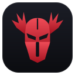
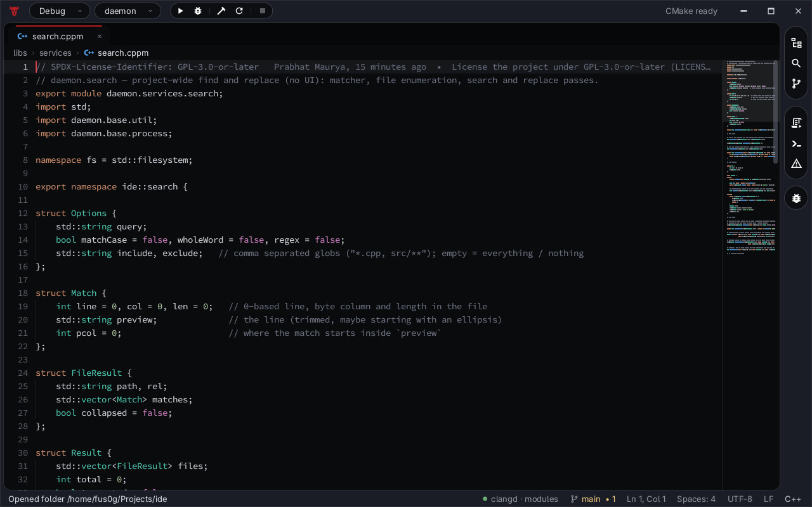

<div align="center">



# Daemon

**A fast, native C++ IDE for Linux — Wayland, Vulkan, no toolkit.**


[](LICENSE)




</div>

Daemon is an IDE written from scratch in **C++23 with C++20 modules** (`import std;` throughout). It talks to Wayland directly,
draws its whole interface with a small instanced-quad **Vulkan 1.3** renderer, and aims for the CLion / VS Code / Zed
experience: a dark, glassy "island" UI with Material icons and a Targaryen-crimson accent.

It is small, starts in well under a second, idles at zero wakeups, and prefers your integrated GPU so it stays cool.

## Features

- **Editor** — tabs, split panes, drag & drop, minimap, breadcrumbs, syntax highlighting, find/replace, animated caret, multi-pane layouts.
- **C/C++ intelligence** — [clangd](https://clangd.llvm.org) completion, diagnostics, hover, go to definition, header/source switch,
  project-wide problems, and **C++20 modules** support (`import std;`, project modules) with a derived Clang compile database.
- **CMake** — configure, build, run and regenerate from the toolbar; profiles, targets, program arguments, clickable compiler errors.
- **Debugger** — full **gdb** integration: breakpoints (conditional, logpoints, data, function, C++ throw), stepping, call stack and
  threads, variables with STL pretty-printing, watches, hover values, debug console.
- **Git** — gutter changes, inline blame, stage/commit/pull/push, history graph, branches.
- **Search & replace** — project-wide, regex / case / whole word / globs, safe replace.
- **Integrated terminal** — real PTY shell with a truecolor xterm emulator.
- **Explorer** — Material icons, git status, drag to move, live refresh on external changes, trash support.
- **Markdown preview** — `Ctrl+Shift+V` opens a live rendered view beside the editor: headings, lists, tables, code with syntax colours, working links and real images (PNG, JPEG, SVG, badges).
- **Sessions** — open tabs, split layout, cursors and scroll position come back when you reopen a project (a plain launch continues the last one).
- **Projects** — welcome screen, new-project wizard (C++, modules, library, C), recent projects, system folder chooser.
- **Look** — translucent chrome with compositor blur (`ext-background-effect-v1`), client-side decorations, HiDPI.

See the [user guide](docs/USER_GUIDE.md) and [feature inventory](docs/FEATURES.md) for details and shortcuts.

## Requirements

- Linux with a **Wayland** compositor (GNOME 51+/KWin recommended for background blur; works without it)
- A **Vulkan 1.3** capable GPU and driver
- **GCC 15+** (or Clang with libc++), **CMake 4.3+**, **Ninja**
- Development packages: `wayland-client`, `wayland-cursor`, `xkbcommon`, Vulkan headers/loader, and `glslc` **or** `libshaderc_shared`
- Optional at run time: `clangd` (code intelligence), `gdb` (debugger), `git`, `curl` (remote images in the Markdown preview)

On Fedora: `sudo dnf install gcc-c++ cmake ninja-build wayland-devel libxkbcommon-devel vulkan-headers vulkan-loader-devel glslc clang-tools-extra gdb git`

## Build & run

```sh
git clone <repo-url> daemon && cd daemon
cmake -S . -B build -G Ninja
cmake --build build
./build/app/daemon [folder-or-files...]
ctest --test-dir build            # or ./build/tests/daemon_tests
```

Optional desktop integration (icon + launcher entry): `cmake --install build --prefix ~/.local`

| Option / variable | Effect |
|---|---|
| `--font-size <px>` | editor font size |
| `--screenshot out.png`, `--keys "ctrl+f\|t:text\|enter"` | render headlessly and replay input (used by the tests) |
| `IDE_FONT`, `IDE_UI_FONT` | code / interface font files |
| `IDE_GPU=<index>` | force a Vulkan device (integrated GPU is the default) |
| `IDE_CLANGD=/path` | clangd binary |
| `DAEMON_OPAQUE=1` | disable translucency |

## Key bindings

| | |
|---|---|
| `Ctrl+O` / `Ctrl+Shift+O` | open file / folder |
| `Ctrl+Shift+F` / `Ctrl+Shift+G` | project search / source control |
| ``Ctrl+` `` | terminal |
| `Ctrl+F9` / `Shift+F10` / `Shift+F9` | build / run / debug |
| `F9` `F10` `F11` `F5` | breakpoint, step over, step into, continue |
| `F12`, `Alt+Left`, `Alt+O` | go to definition, back, header/source |

Full list in the [user guide](docs/USER_GUIDE.md#keys).

## Architecture

Daemon is a stack of static libraries made of C++20 modules (`.cppm` interface + `.cpp` implementation unit); dependencies point downward.

```
app/             the IDE (class App, one implementation file per feature)
libs/services/   clangd, CMake, git, gdb, search, terminal emulator, project, explorer   (no UI)
libs/ui/         Wayland window, Vulkan renderer, fonts, icons                          (reusable, no IDE logic)
libs/text/       buffer, syntax highlighting, document editing
libs/base/       utilities, JSON, processes / PTYs
tests/           headless unit tests
```

Deeper reading: [ARCHITECTURE](docs/ARCHITECTURE.md) · [SUBSYSTEMS](docs/SUBSYSTEMS.md) · [DEVELOPMENT](docs/DEVELOPMENT.md) ·
[DESIGN](docs/DESIGN.md) · [KNOWN_ISSUES](docs/KNOWN_ISSUES.md). AI agents and new contributors should start with [AGENTS.md](AGENTS.md).

## Contributing

Issues and pull requests are welcome. Please build and run the tests (`cmake --build build && ./build/tests/daemon_tests`) before
sending a change, keep commits focused, and look at the screenshot output (`--screenshot`) for UI changes. Contributions are
accepted under the project licence.

## License

Daemon is free software under the **GNU General Public License v3.0 or later** — see [LICENSE](LICENSE). You may use, study,
modify and redistribute it; a modified version you distribute must be released under the same licence with its complete source,
so improvements flow back to the community. Bundled third-party files and their licences are listed in
[THIRD_PARTY_NOTICES.md](THIRD_PARTY_NOTICES.md).
